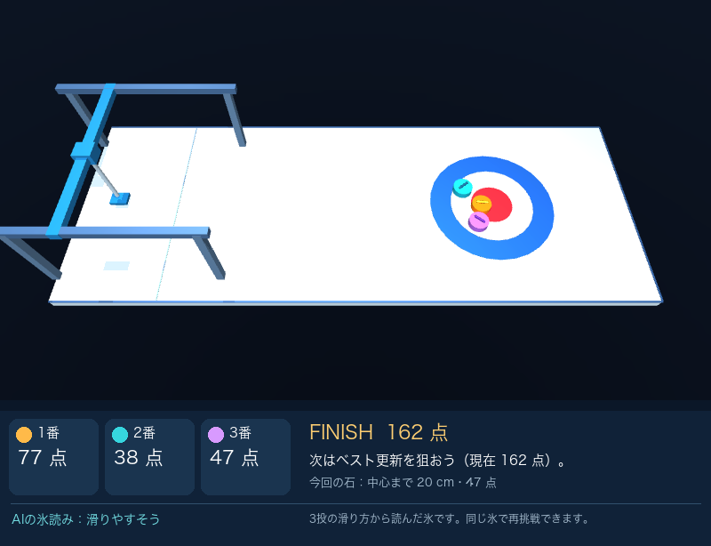
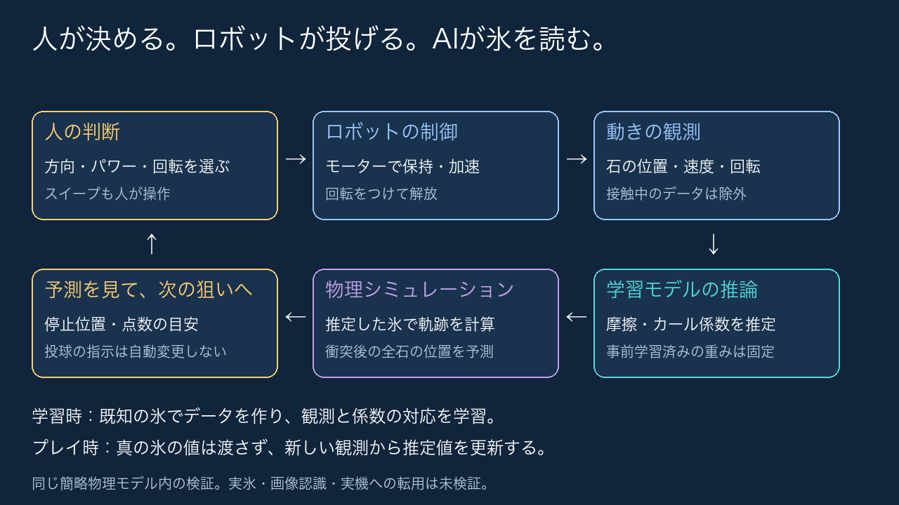

# ロボット・カーリング

氷の滑りやすさが投球ごとに変わる、1人用のカーリングゲームです。
プレイヤーが方向・強さ・回転を選び、ロボットが石を投げます。
AIは石の動きから氷の状態を推定し、止まりそうな位置と点数を画面に示します。

カーリングをよく知らない人にも、氷の状態を読み、狙いを工夫する面白さを知ってもらうことを目指しました。
AIの予測を手がかりに、直接中心へ寄せるか、自分の石を押し込むかを試し、狙いと結果を比べながら考えられるゲームにしています。

Physical AI講座 2026 応用編1の最終課題として作成しました。提出アカウントは `bonsai2026` です。
[説明資料（3ページ）](docs/説明資料_PAI最終課題_bonsai2026.pdf)に、ゲームの概要、AIの役割、実験結果をまとめています。
[デモ動画（YouTube・限定公開）](https://www.youtube.com/watch?v=iWKqMiYL_k0)は2分56.2秒です。表紙、制作の目的、学習した式、投球の段階ごとの予測の使い方を説明しています。



## ゲームの進め方

1ゲームは3投です。すでに置いた石を押し込むなどして、最後の3個の配置で得点を競います。
的の円（ハウス）の中心は100点。中心から離れるほど点が下がり、外周にかかる石には最低1点を与えます。
完全に外なら0点です。公式競技とは異なる、このゲーム独自の採点です。

1. 方向とパワーを選び、回転を「左・なし・右」から選びます。
2. 半透明の予想停止位置と予想合計点を参考に、「この狙いで投げる」を押します。
3. 滑走中にSpaceを押している間はスイープできます。石が少し先まで進みます。
4. 止まったら、中心までの距離・各石の点数・今回の増減点を確認します。

ハウスを拡大して狙えます。方向は0.5度、パワーは1ずつボタンで微調整できます。
「同じ条件でリトライ」すると、氷と盤面、ゲーム中の推定を初期状態に戻せます。
ベスト得点は、画面を開いている間だけ保存します。

予測は「ここからスイープしない」場合の目安です。投球の段階によって、使える情報が変わります。

| 段階 | 予測の役割 |
| --- | --- |
| 1投目・投球前 | 標準の氷で計算した、大まかな目安 |
| 1投目・滑走中 | 今回の氷を推定し、停止位置を読み直す |
| 2・3投目・投球前 | 前投の推定を使い、方向と強さの狙いを検討する |

2・3投目も滑走中に推定を更新します。次の投球の氷がどう変わるかは、投げるまで分かりません。

## 起動

Python 3.12とMuJoCo 3.17.0を使用します。macOS / Apple Silicon、Python 3.12.15で動作を確認しました。
以下は `uv` がインストールされた環境で、プロジェクトのルートから実行します。

```bash
uv venv --python 3.12
uv pip install -r requirements.txt
.venv/bin/python src/game.py play
```

既存の仮想環境がある場合は、最後の1行だけで起動できます。
動画と同じ氷で遊ぶ場合は `play --demo`、別の条件で遊ぶ場合は `play --seed 42` のように指定します。

操作画面にはTkinterとデスクトップの描画環境が必要です。Tkinterはpipの依存一覧には含まれません。
学習・数値評価は画面なしで実行できます。動画にはMuJoCoの描画環境と日本語フォントが必要です。
フォントはmacOSのヒラギノ、LinuxのNoto Sans CJK、Windowsのメイリオを探索します。他OSでの動作は未検証です。

## AIと物理計算の役割

石の減速や曲がり方から、氷の摩擦と曲がりやすさを推定する回帰モデルを学習しました。
学習用データは189投、設定の調整用データは72投です。
ゲーム中は学習済みのモデルを固定し、約0.6秒分の観測から氷の推定値を更新します。

停止位置は、その推定値を使って別の物理シミュレーションで計算します。衝突で動く他の石も含めて予測します。
本番の氷の正解値や、これから行うスイープ操作は予測に渡しません。投球の指示はプレイヤーが決めます。



## 試して分かったこと

24ゲーム・72投を同じ操作で比較しました。場内に止まった石について、各時点で予測した停止位置のずれを平均すると、次の結果でした。

| 予測した時点 | 標準の氷で固定 | 観測から補正 |
| --- | ---: | ---: |
| 1投目・投球前 | 29.01 cm | 29.01 cm |
| 1投目・解放1秒後 | 13.32 cm | 5.79 cm |
| 2投目・投球前 | 11.20 cm | 2.41 cm |
| 3投目・投球前 | 7.83 cm | 1.58 cm |

初投前は観測がなく、細かな狙いには頼りにくい予測です。観測が集まった初投の滑走中と、前投の推定を使える2・3投目の投球前に補正の効果が現れました。
これは予測精度の比較です。同じ操作ならゲームの得点は同じであり、人の得点向上を示す結果ではありません。
[全体評価の条件と結果](report/game_evaluation.json)に記録しています。

別の衝突検証96投では、物理式で氷を推定する方法とも比べました。
小さい観測誤差を加えた条件の平均のずれは、固定値9.90 cm、物理式2.29 cm、学習モデル2.29 cmでした。
この既知の物理法則では、観測から補正する効果は確認できましたが、学習モデルの方が正確だとは言えませんでした。
比較条件と最大誤差も含む結果は、[3方式の比較](report/game_method_comparison.json)にまとめています。

制作者1名の比較プレイでは、予測なし→ありの得点は56→140点、0→28点でした。
面白さなどの5段階評価は、どのゲームも3でした。少人数・少試行の結果なので、一般的な効果とは言えません。
その後の画面改修では操作性が改善したとの感想を得ましたが、得点・5段階評価の再測定はしていません。
[比較プレイの結果](report/game_playtest_evaluation.json)と[手順](docs/playtest.md)を参照してください。

氷・曲がり・スイープは簡略化しています。実際の氷や実機での検証は行っていません。
観測誤差が大きいかすり衝突では、予測が最大65.84 cmずれる例もありました。予測は目安です。

## 検証と再生成

```bash
# 自動テスト
.venv/bin/python -m unittest discover -s src -p 'test_*.py' -v

# 画面を開き、3投を自動操作して終了
.venv/bin/python src/game.py gui-smoke --demo

# 表示が切り替わっても映像の位置が動かないことを確認
.venv/bin/python src/check_ui_layout.py

# 24ゲームの予測精度を評価
.venv/bin/python src/game.py evaluate

# 物理式との比較と、動画に使う説明図を生成
.venv/bin/python src/game.py compare

# 動画を再生成
.venv/bin/python src/game.py video
.venv/bin/python docs/edit_video_text.py

# 操作記録から停止位置・得点を再現
.venv/bin/python src/game.py check-replay --record report/game_demo_replay.json
```

学習データも作り直す場合は、`curved_poc.py run --regenerate`、`collision_poc.py run --regenerate`、
`collision_poc.py diagnose` を同じPythonで順に実行し、その後に上記の `evaluate` と `compare` を実行します。
各コマンドは同名の成果物を上書きするため、編集した資料は別名で保存してください。

提出用PDFは読みやすさを優先して文章を編集した版です。
`game.py report` は技術検証時の草稿を再生成するコマンドで、提出版の文章とは異なります。

## ファイルの構成

| 場所 | 内容 |
| --- | --- |
| `src/game.py` | ゲームの起動、3投の進行、記録、リトライ |
| `src/physics.py` / `game_scene.xml` | ロボット、石の動きと衝突、採点 |
| `src/predictor.py` | 学習モデルによる氷の推定、停止位置の予測 |
| `src/ui.py` / `player_view.py` | 操作画面と得点・予測の表示 |
| `src/analysis.py` / `comparison.py` | 実験、比較図、動画、技術資料の生成 |
| `report/` | 学習済みモデル、実験データ、集計結果、説明図 |
| `docs/` | 提出用の説明資料、要件・実装・検証の記録 |
| `docs/edit_video_text.py` | 提出動画の表紙、説明スライド、文章の編集 |

`learning_poc.py`、`curved_poc.py`、`collision_poc.py` などは、段階ごとの検証に使ったコードです。
現在のゲームの入口は `src/game.py play` です。
動画・仮想環境・課題の原本PDF・個別の比較プレイ記録は、配布するコード一式に含めません。
実装・検証・資料の作成には、OpenAI Codex（使用モデル：`gpt-6.1-sol`、`gpt-6-astra`）の支援を受けました。
