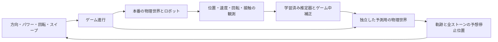

# ロボット・カーリング：実装仕様 v0.3（ゲーム統合反映）

作成日：2026年10月30日。対応する要件：[requirements.md](requirements.md)。

本書はゲームの合意済み要件を実現する設計案。方式・パラメータ・性能目標は技術検証で更新する。
回転付き投球・衝突・平面物理・先読み整合性・操作画面はPoCで検証した。
2026年10月31日、直線ショットの摩擦推定を独立した学習PoCで検証した。
2026年11月1日、単独石の回転・カール・スイープへ拡張し、観測から独立したMuJoCo世界への復元を検証した。
同日、観測からの全石復元と衝突予測を検証し、3投の逐次補正とGUIへ接続した。
24ゲームの全体評価、画面の3投自動操作、動画・説明PDFのローカル生成まで完了した。
本人1名の比較プレイを実施し、画面全体の上下移動を修正した。改修版を本人が操作し、操作性が改善したように思うとの感想を得た。2026年11月2日、物理式との対照実験と、予測・結果・AIの役割を示す説明図を追加した。内容の確認、アカウント名の確定、公開・提出が残る。提出は指示により保留している。
[PoCの結果とモデル変更の根拠](poc_findings.md)を参照。

## 1. 構成と実装範囲

Python 3.12、MuJoCo 3.17.0、NumPy、Tkinter、Pillowを基本構成とする。
AIは小規模な教師あり回帰と逐次的な推定値の更新を使う。外部API・GPU学習は前提にしない。

本番と予測は同じ運動・衝突・カール・スイープの計算を使い、氷のパラメータを分離する。
本番は内部の真値を使い、予測は観測から得た推定値を使う。予測を実行しても本番の石・時刻・投球数・乱数状態は変えない。

現在のファイル構成は以下とする。不要な階層は増やさない。

| ファイル | 責務 |
| --- | --- |
| `src/game.py` | 設定、ゲーム進行、採点、リトライ、起動コマンド |
| `src/physics.py` | MuJoCo世界、ロボット、氷、追加力、停止・場外判定、観測・状態復元 |
| `src/predictor.py` | 事前学習、氷の推定、ゲーム中補正、先読み計算 |
| `src/ui.py` | 操作部、3D表示、予測表示、入力イベント処理 |
| `src/analysis.py` | 学習・評価データ、リプレイ、図・動画・説明資料の出力 |
| `src/comparison.py` | 既存96投で物理式と学習の変換係数を比較、観測時点を固定した説明図を生成 |
| `src/game_scene.xml` | 直交ロボット、3個の石、床、ハウス、拘束、接触設定 |

ゲームのエントリーポイントは `src/game.py`。`src/poc.py`は既知の氷を使う技術検証用として残す。
`physics.py`、`ui.py`、`game_scene.xml`、`game.py`、`analysis.py`を実装済み。
`predictor.py`は摩擦・カール推定、ゲーム中補正、全石のMuJoCo予測を実装した。
検証用の`learning_poc.py`は直線版、`curved_poc.py`は回転・スイープ版を学習・評価し、`collision_poc.py`は保存したモデルで衝突予測を評価する。

旧 `curling.py` と `scene.xml` は新実装の検証が済むまで参考として保持する。
新成果物の名前に `game_` を付け、旧試作の結果と区別する。

## 2. 状態とデータの境界

| データ | 主な内容 | 読み取り先 |
| --- | --- | --- |
| `ShotCommand` | 方向、パワー、回転選択 | ロボット制御、予測 |
| `Observation` | 時刻、投球済み石のID・位置・姿勢・速度・角速度・接触状態、実行済み操作 | AI、表示、記録 |
| `IceTruth` | 本番の摩擦、カール係数、投球ごとの変化 | 本番の物理世界、評価専用の記録 |
| `IceEstimate` | 観測から推定した摩擦・カール係数、観測の有効性 | 予測 |
| `Prediction` | 入力の版番号、石ごとの予想軌跡・停止位置・場外判定、前提とするスイープ操作 | 表示、評価 |

AIへ `IceTruth`、本番の `mjModel`、将来の投球結果は渡さない。
石の現在の位置・速度などは、シミュレータから取得する観測として利用する。画像認識は対象外。
物体の寸法・質量やロボットの制御方法は既知の共通設定として扱う。

## 3. ゲーム進行と操作

状態は次の順で遷移する。

`READY → DELIVERY → SLIDING → SETTLING → READY または RESULT`

- `READY`：方向・パワー・回転を入力し、予測を確認する。投球ボタンで入力を固定する。
- `DELIVERY`：投球数を1増やし、次の石を初期配置してロボットが保持・加速・回転・解放する。
- `SLIDING`：スイープを受け付ける。投球済みの石すべてを物理計算する。
- `SETTLING`：全対象石が停止条件を一定時間満たすことを確認する。再び動けば `SLIDING` に戻る。
- 1、2投目の完了後は氷を更新して `READY`、3投目の完了後は採点して `RESULT`。
- 例外・不安定な物理状態は `ERROR` として表示し、リトライを可能にする。正常完了として採点しない。

| 入力 | 初期仕様案 |
| --- | --- |
| 方向 | 正面を0度とし、スライダーで−15〜＋15度。上から見て正を左方向とする |
| パワー | 1〜100。ロボット先端の解放時目標速度0.4〜1.9 m/sに線形変換する |
| 回転 | 左・なし・右。解放時目標角速度をそれぞれ＋1.5、0、−1.5 rad/sとする |
| スイープ | 滑走中に画面ボタンまたはSpaceを押している間、有効にする |
| 投球・リトライ | 画面ボタン。投球中の方向・パワー変更や二重投球は受け付けない |

パワーはゲーム内の操作量で、力のSI単位ではない。数値範囲と速度への対応は操作感の検証で調整する。
フォーカス喪失・ボタン解放・ターン終了時にスイープ入力を解除し、押しっぱなし状態が残らないようにする。
2026年11月1日、プレイヤー向けに方向±0.5度・パワー±1の微調整ボタン、ハウスの拡大表示、1投後の予想合計点を追加した。
停止後は中心までの距離・盤面全体の増減点・各石の点数を表示する。ベストは同じ画面の起動中・同じ氷で保持する。
これらは表示・入力の改善であり、物理、採点、学習モデル、人が投球を決めるルールは変更しない。
増減点が負の場合や場外の場合も実結果を表示し、成功の演出で隠さない。11月2日に本人が新画面を操作し、操作性改善の感想を得た。楽しさの比較・5段階評価の再測定は未実施。
リトライは全石、投球数、氷の初期値と変化系列、AIのゲーム中補正、予測・履歴をリセットする。事前学習済みの係数は保持する。

## 4. ロボットと物理

### 4.1 初期パラメータ

以下は仮値であり、実寸のカーリング競技場の再現値ではない。

| 項目 | 仮値・方針 |
| --- | --- |
| 座標・リンク | xが前方、yが左、zが上。x=0〜4.0 m、y=−0.75〜＋0.75 m |
| ハウス | 中心(3.0, 0) m、半径R=0.45 m |
| ストーン | 3個とも半径r=0.07 m、高さ0.05 m、質量0.2 kg |
| 物理刻み | 0.002秒。`implicitfast`、楕円摩擦円錐を初期候補とする |
| 描画 | 通常25〜30 fpsを目標。物理刻みと分離する |
| 停止 | 全対象石の並進速度0.01 m/s未満、鉛直軸角速度0.05 rad/s未満が0.4秒続く |
| 上限時間 | 1投15秒を初期値とする。超過は記録・エラー表示し、強制停止を通常結果と混同しない |

停止閾値は微小振動を考慮して検証する。初期パラメータで停止しない場合は、まず摩擦・減衰・刻みを見直す。

### 4.2 保持・回転・解放

- x・y・zの直交3軸に鉛直回転の1軸を加え、各軸をアクチュエータで動かす。
- 把持は、先端とストーンのハンドル部を結ぶ解除可能なweld拘束で近似する。指とハンドルの細かな接触は対象としない。
- 固定の投球開始位置を(0.30, 0) m、加速区間を約0.35 mとする。
- 指定方向に先端を加速させ、同時に回転を与え、解放地点で拘束を解除する。
- 解放後の石の速度は運動計算から引き継ぐ。投球結果を作るための初速の直接設定は行わない。
- 未投球の石の初期配置と、場外石の除外はゲーム進行上の状態変更として区別する。
- 先端の解放後の退避、力・トルク上限、保持中の振動は最初の技術検証で確認する。
- 投球開始位置に石が重なり準備できない場合は、既存の石を勝手に動かさず、原因を表示してリトライ可能にする。

MuJoCoのweld拘束と実行中の有効・無効の切り替えを使用する設計である。
[公式仕様](https://mujoco.readthedocs.io/en/stable/XMLreference.html#equality-weld)

### 4.3 衝突・カール・スイープ

石同士の衝突はMuJoCoの剛体接触を使う。PoCの接触感度比較から、石の運動を水平2軸と鉛直回転に制限した平面モデルを採用する。
円形同士の接触を固定高さの球形接触で計算し、見た目と慣性は円柱のものを使う。石の傾き・跳ね上がりは対象外。
石同士の接触の `solref` は(0.02, 0.25)をPoCの初期採用値とする。
床からの法線力はmgと仮定し、滑り抵抗 `F = −m μ g v_hat` を明示的に加える。
低速時は1刻みで速度を逆転させない大きさに制限し、回転抵抗も独立に与える。
接触の弾性・減衰・摩擦によるエネルギー損失と回転の移動を確認する。

カールは、回転と速度に応じた横方向の力を石の重心に加えるゲーム用近似とする。
モデルの初期候補は、平面速度u、速さv、角速度ωに対して次の式とする。

`a_curl = κ × tanh(ω / ω_ref) × v / (v + v_eps) × n_left`

- `n_left = (−u_y, u_x) / v`。停止付近では横方向の力を0にする。
- 仮値はκ=0.03 m/s²、ω_ref=1 rad/s、v_eps=0.1 m/s。
- 力の向きを速度に直交させ、カール力自体が並進運動のエネルギーを増やさないことを検証する。
- 回転を反転すればカールの向きが反転し、回転なしではこの追加力を0にする。
- 保持中・場外・未投球の石にカール力を加えない。衝突で動いた他の石には、その石自身の速度・回転から計算する。
- この式は本課題用の近似案であり、実氷の曲がりを定量的に再現したものとして説明しない。

スイープは、投球中の石の前方を掃く効果として、その石の床に対する実効摩擦とカール係数を一時的に変える。
初期候補は `μ_eff = μ × (1 − 0.20 × s)`、`κ_eff = κ × (1 − 0.30 × s)`、sは入力中1、それ以外0。
仮想ブラシを前方に表示し、効果は入力中だけ適用する。加熱の残留、細かなブラシ接触、別ロボットによるブラシ制御は対象としない。
スイープしても逆方向へ加速しないこと、狙える程度の距離・曲がりの差が生じることを検証する。

### 4.4 氷の変化と場外

摩擦は1投の間は一定とし、投球完了後にリンク全体の値を変える。スイープの一時的効果は別に適用する。
初期候補は `μ_k = clip(μ_0 × (1 + k × δ), μ_min, μ_max)`、k=0,1,2。
初期探索範囲はμ_0=0.035〜0.065、δ=−0.05〜＋0.05、上式の下限μ_min=0.02・上限μ_max=0.09とする。
カール係数κは1ゲーム中固定とし、データ生成では0.015〜0.045 m/s²を初期探索範囲とする。
プレイ用の初期値と変化量は固定シードで決定し、リトライで同じ系列を再現する。具体値をAIへ渡さない。
3投で変化を感じられるか、予測補正が追従できるかを確認して変化量を調整する。

場外は石の外縁がリンク範囲を越えた時点とする。石を非表示・非参加状態とし、その後の衝突や採点へ参加させない。
物理的な反射壁は設けない。ハウス外・リンク内の石はそのまま残す。

## 5. 得点計算

dを石の中心からハウス中心までの距離、Rをハウス半径、rを石の半径とする。

| 距離 | 得点の生値 |
| --- | --- |
| `0 ≤ d < R − r` | `1 + 99 × (1 − d / (R − r))` |
| `R − r ≤ d ≤ R + r` | 1点。内接から外接まで、外周にかかる石を含む |
| `d > R + r` または場外除外済み | 0点 |

生値を `floor(score + 0.5)` で整数にする。境界の浮動小数点誤差には小さな許容値を使い、内接・外接・その前後をテストする。
3投完了後の最終位置で再計算し合算する。途中表示を行う場合は「暫定」と明記する。
複数の石は重なれないため、合計300点を達成可能な最高点として表示しない。

## 6. AIの学習・ゲーム中補正・予測

### 6.1 事前学習

最初の学習PoCでは、下記の全範囲に先立ち直線・無回転・スイープなしの摩擦推定だけを検証した。
解放後0.1〜0.5秒の11観測から速度の傾きを求め、標準化した1特徴量の回帰で摩擦を推定する。
学習78投、調整24投、評価72投を氷条件ごとに分離した。停止予測は解析式`Δx = v |v| / (2 μ g)`を使い、
MuJoCoの衝突先読みとの接続は次の段階とする。`GlideObservation`は運動の観測と保持・接触・スイープ状態だけを含み、
真の摩擦、力、内部状態スナップショットを推定器へ渡さない。回転・衝突・スイープを含む窓はこの段階では拒否する。
詳細・数値・観測ノイズへの感度は[PoCの結果](poc_findings.md)に記録した。

回転版では観測を解放後0.1〜0.7秒の16点へ拡張し、`GlideObservation.sweep_seconds`に実行済みスイープの累計時間を記録する。
速度変化は既知のスイープによる抵抗減少で補正し、進行方向の角度変化は速度・角速度・実行済みスイープに応じた露出時間で正規化する。
この2特徴量から別々の回帰で摩擦・カール係数を推定する。スイープの効果率やカールの関数形は既知のゲーム物理として仮定する。
回転の信号が不足する場合はカール係数を保持する。方向変化の回帰残差が大きい場合は前の推定への重みを増やす。
この重みはノイズ対策のヒューリスティックで、統計的に校正された信頼区間ではない。
学習189投・調整72投・評価72投を使用し、摩擦とカール係数の両方の値を分割間で重複させなかった。
単独石の予測は現在の位置・速度・回転だけから新しいMuJoCo世界を作り、「これ以降スイープなし」で計算する。
続く衝突PoCで全石・ロボット状態を含む観測復元を実装し、正面・かすり・連鎖を検証した。
学習済みモデルは固定し、新しい摩擦・カール係数8組で96投を評価した。

- 摩擦、カール係数、方向、パワー、回転、スイープ操作を変えて、描画なしでデータを生成する。初期規模は300〜600投を目安とする。
- 接触や保持の影響がない自由滑走区間から、速度・角速度・速度変化・方向変化・観測時間・実行済みスイープを特徴量にする。
- 標準化とL2正則化付き回帰を用い、観測窓から摩擦とカール係数を推定する小規模なモデルを学習する。
- 回転が小さくカール係数を識別できない区間は、カール係数の更新に使わない。
- 学習ラベルにはデータ生成時の真値を使う。プレイ・評価時の推定入力には真値を含めない。
- データは軌跡・氷条件を単位として学習・検証・評価へ分離する。同じ投球の隣接窓を別の分割に混ぜない。
- 正則化や特徴量の選択は検証用データで行い、評価用データを選択に使わない。

### 6.2 ゲーム中補正

学習済みモデルの重みは固定し、観測から得た氷の推定値を逐次更新する。
採用した更新は `estimate ← (1 − α) × estimate + α × learned_estimate(observation_window)`、α=0.35。
解放0.1秒後から0.04秒間隔で観測し、直近16点（0.6秒）を使い、最短0.2秒間隔で推定を更新する。
サンプルの間に発生した短い接触も記録して窓を捨て、接触加速度を氷の減速と混同しない。
直近の観測を重視し、保持中・衝突中・停止直前などの不適切な区間を除外する。投球中の有効な窓を使い、次投へ引き継ぐ。
有効な観測がない場合は前の推定を保持する。未来の変化系列を推測の正解として注入しない。
ゲーム中は予測に使う物理パラメータの推定を補正する方式であり、ニューラルネット等の全重みを再学習する方式ではない。

### 6.3 先読みと表示

全石予測の実装は`predict_board(BoardObservation, IceEstimate, command)`。
`BoardObservation`には投球済み石のID・場内/場外・位置・速度・姿勢・回転、ロボット4軸の位置・速度、
現在のフェーズ・投球指示・解放時刻などの既知イベントを含める。未投球の石は含めない。
`CurlingWorld.observe_board()`で出力し、独立世界の`restore_observation()`で復元する。
真の氷・適用力・加速度・ソルバの初期解は渡さず、復元後に力を計算し直す。
投球前は提案するコマンドが必要で、投球中は実行済みコマンドを変更しない。場外の石もIDと除外位置を保持する。
投球前・保持中・接触中の復元は正解の氷で整合性を確認したが、学習モデルの精度評価は解放後0.7秒・衝突前に限定した。
未知の氷での投球前予測の評価は、3投の補正・推定引き継ぎと組み合わせて行う。

- 独立した予測世界を共通設定と推定値から作り、観測可能な石・ロボットの状態を復元する。本番のモデルを丸ごと共有しない。
- 現在指定されている1投について、既にある石との衝突・連鎖衝突・場外を含め、全対象石が止まるまで先読みする。未指定の将来の投球は予測しない。
- 予測と本番でロボットの保持・加速・解放方法を揃える。
- 投球前の予測は「スイープなし」。滑走中の更新は、現在の観測から「これ以降スイープなし」として予測する。未入力の将来のスイープは予見しない。
- 石ごとの色で予想軌跡、半透明の石で予想停止位置を表示する。場外予測も表示する。
- 入力変更後の短い待ち時間を置いて再計算する。初期目標は1秒以内の応答。更新頻度は実測で調整する。
- 予測はワーカー1つで実行し、古い入力の計算結果を新しい操作に表示しない。UIから本番状態のスナップショットを渡す。

MuJoCoの状態保存・復元の機能を利用する。保存すべき積分状態と再計算可能な派生値を区別する。
[公式ドキュメント](https://mujoco.readthedocs.io/en/stable/programming/simulation.html#state-and-control)

## 7. 画面・記録・提出物

- Tkinterの1ウィンドウに、MuJoCoのオフスクリーン画像、方向・パワーのスライダー、回転選択、投球・スイープ・リトライ、投球数、得点を置く。
- 斜め上からロボットとハウスを見せる。必要に応じて真上の表示へ切り替える。
- Tkinterのイベント処理と描画はメインスレッド、予測計算は独立した世界を持つワーカーで行う。ワーカーからGUI・OpenGLを操作しない。
- 物理刻みは固定し、UI更新と分離する。描画遅延によって物理刻みを変えない。リアルタイム性は技術検証で確認する。
- 予測ボタン待ち・計算中・不正入力・停止時間超過を画面に表示する。前提の異なる予測や古い予測を正確な結果のように残さない。
- 記録には設定・シード・モデル版、投球コマンド、シミュレーション時刻に対応するスイープ入力、観測、予測、最終位置・得点を含める。
- 評価専用の記録に限り氷の真値を含め、AIに渡す観測と分離する。
- 新成果物は `report/game_curved_model.json`、`report/game_evaluation.json`、`report/game_*.png`、`report/game_report_draft.*`、`video/game_demo.mp4` を基本とする。
- 提出候補の動画は100.2秒。同じゲーム実装への入力記録の再生を使用し、動作部分は等速、説明中は静止と明記する。
- 新しい評価結果で説明資料を作り直す。公開GitHub・YouTube・omnicampusへの提出は別の手続きとする。

Tkinterのイベントループを塞がない設計にする。[Python公式ドキュメント](https://docs.python.org/3.12/library/tkinter.html#threading-model)

## 8. 検証と完成判定

以下は受け入れ確認の初稿。精度・時間の数値は技術検証後に再確認する。

| 分類 | 確認項目 |
| --- | --- |
| ゲーム | 3投を通して遊べる。二重投球・無料試投が発生しない。全石の停止後に最終採点される |
| 得点 | 中心100点、内接・外接1点、完全に外なら0点。距離による単調性と衝突後の再採点を確認する |
| 物理 | 正面衝突・かすり衝突・3個の連鎖衝突を確認。NaN、跳ね上がり、エネルギーの異常増加を検出する |
| 回転・カール | 回転の左右反転で曲がる向きが反転し、回転なしで追加のカールが生じない |
| スイープ | 同じ初期状態・投球でON/OFFを比較し、距離・曲がりに差が出る。入力解除が確実に反映される |
| 場外 | 壁で反射しない。除外石が他の石に影響せず、ハウス外・リンク内の石は残る |
| 予測 | 無衝突、正面衝突、かすり、連鎖を分けて全石の停止誤差と場外判定を評価する |
| 学習 | 氷条件と軌跡を分離した評価で、ゲーム中補正あり・なしを同じ投球・氷系列で比較する |
| 情報分離 | 真の氷パラメータへアクセスできない入力だけで予測できる。予測前後で本番状態が不変である |
| リトライ | 同じ入力列で同じ結果が再現され、AI補正も初期状態に戻る |
| 表示 | 予測応答1秒以内を初期目標とし、描画・入力が操作を妨げないか実機で確認する |
| 提出 | 新仕様の1〜3分の動画、再現手順、コード、説明資料を揃え、旧試作の数値を流用しない |

停止位置誤差は石のIDを保って計測し、平均に加えて中央値・大きな誤差・場外の正誤を報告する。
場外除外で座標を変更する場合は、除外直前の位置を別に記録する。
予測精度の初期目標は平均誤差が石の直径0.14 m以内。必達を保証する値ではなく、かすり・連鎖を含む達成状況を公開する。
補正ありとなしの比較では人の入力列を揃える。AIが予測表示だけを担当する場合、同じ入力で得点が上がるとは主張しない。

## 9. 実装順序と工数

以下は設計時点の見積もりを記録として残したもの。実測工数ではない。現在の残件は[提出準備チェックリスト](submission_checklist.md)を参照。

AIによるコード作成支援を前提に、ユーザーの依頼・実行待ち・動作確認・調整・提出準備に必要な作業時間の暫定見積もりとする。

| 作業 | 暫定見積もり |
| --- | --- |
| ロボット・物理（最初の技術検証を含む） | 5〜7時間 |
| 操作画面・3投のゲーム進行・採点 | 2〜3時間 |
| 学習・逐次補正・衝突後の先読み | 4〜6時間 |
| 統合確認・予測評価・操作感の調整 | 2〜3時間 |
| 動画・説明資料・公開と提出の準備 | 2〜3時間 |
| 不具合対応の予備 | 3〜4時間 |
| **合計** | **18〜26時間** |

20時間は目標の作業枠であり、現段階の見積もりの上限ではない。
目標配分は物理5・画面2・AI4・確認2・提出3・予備4の計20時間とする。

### 最初の技術検証：1〜2時間（物理の工数内）

技術PoCで実施済み。14項目の自動確認、20投の安定確認、GUIの短い自動操作を通過した。
この段階の別世界の一致確認は既知パラメータでの結果。学習済みAIは後続の単独石・衝突・全体評価で別途検証した。

1. 保持・回転・解放を行い、入力方向・速度・回転が石に伝わるか確認する。
2. 2個の衝突と3個の連鎖を作り、同じ状態からの別世界の計算と比較する。
3. 3個の先読みの実行時間と、Tkinter・MuJoCo描画の同居を計測する。

ここでは予測用に既知パラメータを使った一致確認も行うが、AIの性能評価とは分ける。
目安は投球20回連続で異常なし、先読み1回1秒以内、入力を受け付けながら描画できること。
未達なら原因・代替案・工数を整理し、基盤を見直す。ゲームの合意済み要件を無断で削って成功扱いにしない。

### その後の順序

1. 物理と3投のゲーム進行を統合し、カール・スイープ・採点・リトライを通して遊べるようにする。
2. 事前学習と観測境界を実装し、全石の先読み表示とゲーム中補正を接続する。
3. 評価と操作確認を行い、動画・説明資料・再現手順を揃える。
4. 残り時間は不具合修正と提出を優先する。

スイープ助言、多関節アーム比較、独立した練習モードは追加候補。
基本ゲームと提出物が揃い、予備時間を確保できた場合にのみ着手する。

## 10. 根拠と未検証事項

人による操作の比較用に`src/playtest.py`を追加した。練習2ゲームと本番4ゲームで予測表示あり・なしを比較し、
同じ氷の組を2組使って順番を逆にする。得点・選択時間・5段階の感想をローカルへ保存する。
機能確認の自動操作は別の記録種別・保存先を使い、人の評価として集計しない。[比較プレイの手順](playtest.md)を参照。

- 手元の環境で、旧試作の8秒分の1球計算は約0.11秒だった。3球・追加力・AIを含む速度の保証には使わない。
- TkinterとMuJoCo描画の同居はPoCの約6秒の自動操作で約31 fps、先読み応答約0.21〜0.46秒、記録されたエラーなしだった。
- 保持・回転・解放、別世界での先読み、3投進行とリトライをPoCで確認した。本人1名の比較では得点差が両組で正、面白さ等の回答差は0だった。改修後の本人の操作感の感想は改善方向だが、比較プレイの再測定とは区別する。
- 物理は平面モデルへ変更した。カール・スイープの作用、学習器の特徴量、推定精度を検証した。実氷の再現は未検証。
- 参考：[カーリングの実測研究](https://www.nature.com/articles/s41598-022-19303-4)。実氷の微細な機構の解明や実験再現は、本課題の目標に含めない。
