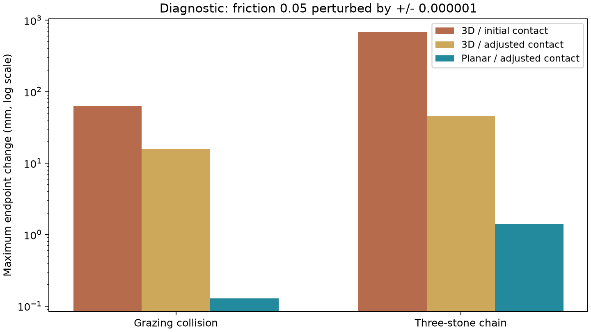
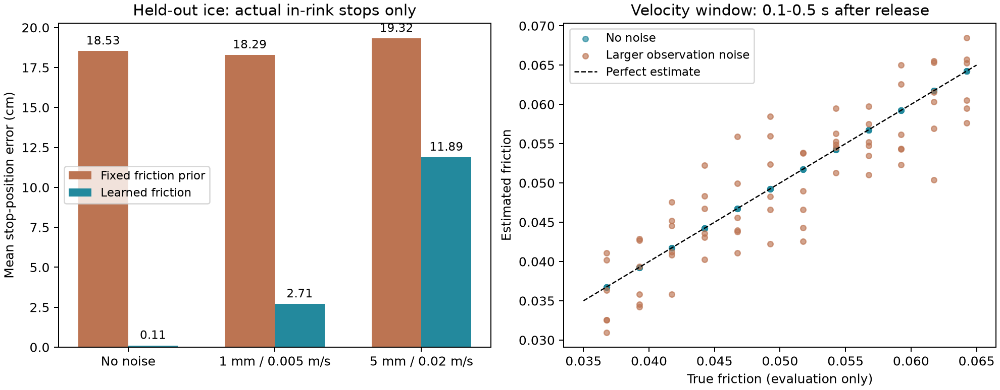
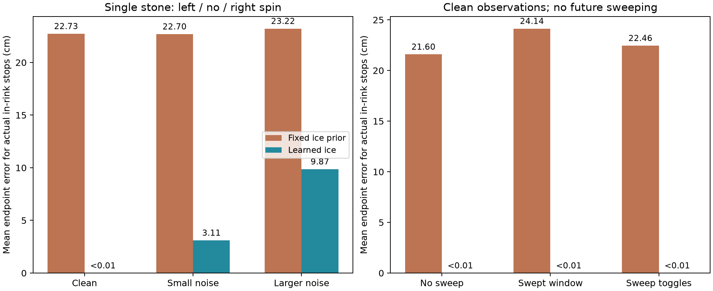
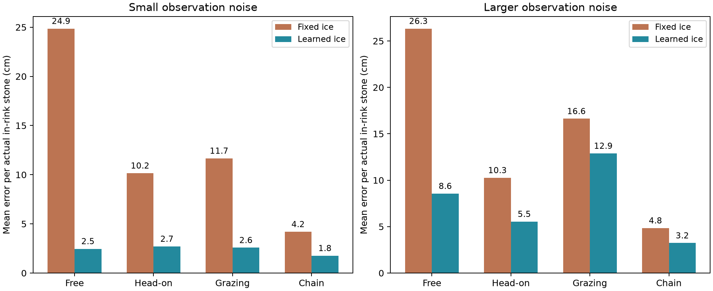

# 3投カーリング：技術PoCの結果

実施日：2026年10月30日。対象は[実装仕様](implementation_spec.md)の最初の技術検証。
2026年10月31日に、末尾へ直線ショットの学習PoC結果と残件を追加した。
2026年11月1日に、さらに回転・カール・スイープの学習PoCを追加した。最新の残件は末尾の「現在の判断と残件」を参照。
同日、衝突後の全ストーン予測と失敗例の分析を追加した。

## 判断

ロボットによる回転付き投球、複数石の衝突、別世界での先読み、操作画面の同時動作は確認できた。
ゲームの方向性は継続する候補とし、物理の扱いを平面モデルへ変更する。
次の検証対象は未知の氷の推定と学習済みAIによる予測。完成版の精度・工数はまだ確定していない。

今回の予測は、氷のパラメータを明示的に与えた物理計算である。
学習済みAIは未接続であり、課題のAI活用要件を満たした完成物として扱わない。

## 動かせるもの

- x・y・zと回転の4軸をアクチュエータで制御する直交ロボット。
- weld拘束で石を保持し、加速・回転後に解除する。解放時の石の速度を直接設定しない。
- プレイヤーが方向・パワー・回転を入力し、3個の石を残しながら投球する画面。
- 押している間のスイープ、投球間の摩擦変化、場外除外、距離による採点、リトライ。
- 既知の氷条件での予想軌跡・衝突後の停止位置の表示。
- 正面衝突・かすり衝突・3個の連鎖衝突などの確認用動画。

## 測定結果

手元のmacOS / Python 3.12.15 / MuJoCo 3.17.0で実行した。

| 項目 | 結果 |
| --- | --- |
| 自動確認 | 14項目通過。条件を変えた20投の安定確認を含む |
| 別世界の先読み | 確認した5ケースで最長約0.24秒。既知条件で実行結果と一致 |
| GUI確認 | 約6秒の自動操作で約31 fps、予測応答約0.21〜0.46秒、記録されたエラーなし |
| 3投進行 | 固定した入力列で完走し187点。4投目を拒否。これはゲームの最高点やAI性能ではない |
| スイープ | 同じ投球の停止xが約2.88 mから3.45 mへ変化 |
| 確認用動画 | 1280×720 / H.264 / 25 fps / 35.88秒 |

既知条件の先読み一致は、状態の復元・計算の整合性の確認であり、未知条件を予測するAIの精度ではない。
GUIの自動操作は、手動で遊んだ際の快適さを保証するものではない。
今回の動画は技術確認用で、最終提出の1〜3分の動画は別途作成する。

## 物理モデルを変更した理由

最初は自由な3D運動の円柱同士を接触させた。
この設定では、摩擦を0.05から±0.000001だけ変えたときにも停止位置が大きく変わる診断ケースがあった。
接触の設定を緩めた3Dモデルと、平面モデルの両方を比較した。

次の数値は、各ケースで2通りの微小変化を与え、対象石の停止位置の差の最大値を取ったもの。
一般的なMuJoCoの精度や全ショットの誤差を表す数値ではない。

| モデル | かすり衝突 | 3個の連鎖 |
| --- | --- | --- |
| 3D・初期接触設定 | 約62.5 mm | 約685.2 mm |
| 3D・調整した接触設定 | 約15.9 mm | 約45.6 mm |
| 平面・調整した接触設定 | 約0.13 mm | 約1.40 mm |



採用する平面モデルでは、石は水平移動2軸と鉛直回転1軸で動く。
円形同士の接触を、固定高さの球形接触で計算し、見た目は円柱にする。慣性は円柱の値を使う。
法線力をmgと仮定してクーロン滑り抵抗と回転抵抗を明示的に与える。石の傾き・跳ね上がりは対象外。
ロボットは3Dの直交3軸＋回転軸のままとし、保持・解放の動作は維持する。
カールとスイープの近似も維持する。このモデル変更は、ゲーム要件を減らす変更ではない。

摩擦の誤差が大きい場合の影響は引き続き残る。採用モデルで摩擦を5%小さく見積もった診断では、
各ケースの最大停止誤差は正面約7.4 cm、かすり約7.0 cm、連鎖約3.2 cmだった。
未知の氷をどの程度正しく推定できるかは、次の学習PoCで確認する。

## 確認方法

プロジェクトルートで、既存の仮想環境を使って実行する。

```bash
# 描画なしの技術確認
.venv/bin/python src/poc.py check

# 3Dと平面モデルの接触感度比較
.venv/bin/python src/poc.py compare-contact

# 手動で遊ぶ。画面のスライダーと回転選択、Spaceで操作
.venv/bin/python src/poc.py play

# GUIの短い自動操作確認（ウィンドウが開いて自動で閉じる）
.venv/bin/python src/poc.py gui-smoke

# 確認用動画を生成
.venv/bin/python src/poc.py video
```

`play`、`gui-smoke`、`video`には描画可能なデスクトップ環境が必要。
各確認コマンドは同名の結果ファイルを上書きする。

## ファイル

- [自動確認の結果](../report/poc_results.json)
- [接触モデルの比較データ](../report/poc_contact_comparison.json)
- [GUI確認の結果](../report/poc_gui_results.json)
- [確認用動画](../video/game_poc.mp4)
- 実装：`src/physics.py`、`src/game_scene.xml`、`src/poc.py`、`src/ui.py`

## 次の検証とピボット判断

1. 観測だけから摩擦・カール係数を推定する学習器を作る。事前学習・評価の氷条件を分ける。
2. 既知条件の予測に代えて推定値で先読みし、無衝突・正面・かすり・連鎖の誤差を確認する。
3. 投球間に氷が変わる3投で、補正あり・なしを同じ入力列で比較する。
4. 精度や工数が厳しい場合は、表示する予測の不確かさ、学習方式、機能の優先順位を見直す。
   合意済みの予測範囲やゲームルールを変更する場合は、結果と代替案を提示して相談する。

スイープ助言、多関節アーム比較、独立した練習モードは引き続き追加候補とする。

## 追加検証：直線ショットの摩擦学習（2026年10月31日）

### 試したこと

残件①の最小部分として「1球・直線・回転なし・スイープなし」を実装・評価した。
新ゲームと同じMuJoCo世界でロボットが石を解放し、その0.1〜0.5秒後を0.04秒間隔で観測する。
11点の速度から減速率を求め、摩擦との関係を事前学習した1特徴量の回帰モデルへ入力する。
0.5秒時点の位置・速度と推定摩擦から、クーロン摩擦の解析式で停止位置を計算する。
場外になる場合は境界までの予測とし、場外除外位置を停止位置と呼ばない。

真の摩擦は教師ラベルと評価専用の記録に使い、推定器には渡さない。
推定器の入力は時刻、位置、速度、角速度、保持・接触・スイープ状態のみ。
本番のモデルや適用力を含む完全なシミュレータ状態は渡さない。
今回の推定・予測は滑走中の観測が必要であり、未知の氷での1投目の投球前予測ではない。

| データ | 規模 | 用途 |
| --- | --- | --- |
| 学習 | 摩擦13条件 × パワー6条件 = 78投 | 回帰係数を学習 |
| 調整 | 別の摩擦6条件 × パワー4条件 = 24投 | 正則化の強さを選択 |
| 評価 | さらに別の摩擦12条件 × パワー6条件 = 72投 | 学習・調整に使っていない条件で比較 |

摩擦は約0.035〜0.065の範囲で、学習・調整・評価の値を重複させない。評価は学習範囲内の未知の値であり、範囲外への外挿ではない。
比較相手は学習条件の平均摩擦0.05を使う固定予測。両方式に同じ観測位置・速度を渡し、摩擦の推定方法だけを変える。

### 結果

72投のうち、実際にリンク内で停止した69投の停止位置誤差を下表に示す。残り3投の場外は別に判定する。
ノイズは各観測の位置・速度に独立な正規分布として加えた。ノイズの数値は各軸の標準偏差。
3種類のノイズ条件で同じ72軌跡を使うため、独立した216投を試したという意味ではない。

| 観測ノイズ：位置 / 速度 | 固定摩擦の平均誤差 | 学習モデルの平均誤差 | 学習モデルの95%点 / 最大 | 場内・場外の正答 |
| --- | --- | --- | --- | --- |
| なし | 18.53 cm | 0.11 cm | 0.14 / 0.14 cm | 72/72 |
| 1 mm / 0.005 m/s | 18.29 cm | 2.71 cm | 7.80 / 13.02 cm | 72/72 |
| 5 mm / 0.02 m/s | 19.32 cm | 11.89 cm | 26.54 / 31.92 cm | 71/72 |

ノイズなしでは摩擦推定の平均絶対誤差は約9.6×10⁻¹¹だった。
同じ単純な摩擦法則で正確な速度を観測しているため、これは難しい未知物理の学習に成功したことを意味しない。
減速率と摩擦の関係はこの条件ではほぼ線形で、物理式からも求められる。今回確認したのは、学習・観測の分離・予測・評価を通せること。
約1 mmの残差には、連続時間の解析式と離散時間シミュレーションの差が含まれる。
大きい方のノイズでは平均が14 cm以内でも、最大約32 cm外れる。平均だけで十分な精度と判定しない。



5項目の評価チェックを通過した。加えて4件の自動テストで、教師ラベルから関係を学ぶこと・保存復元、
保持中/衝突中/スイープ中/回転中/停止付近等の観測を拒否すること、時刻原点によらないこと、場外判定を確認した。
画面や既存の物理コードはこの学習PoCでは変更していない。

### 残った問題と次に試すこと

1. **①は一部完了**：直線の摩擦推定は通過。次は回転・カールとスイープのある観測への拡張。回転がないと曲がりやすさを識別できない点を扱う。
2. **②は未着手**：推定した氷をMuJoCoの独立した先読み世界へ渡し、正面・かすり・連鎖衝突で全石の停止誤差を測定する。今回の解析式だけでは衝突を予測できない。
3. **③は未着手**：投球中の推定を更新し次投へ引き継ぐ。氷の変化への追従と、補正あり/なしの比較を行う。
4. **④は未着手**：操作画面の既知条件予測を学習モデルへ接続する。現行GUIは引き続き氷の正解を使った技術確認用。
5. **⑤〜⑨は残件**：実プレイ調整、ゲーム全体の評価、再現手順の完成、新ゲームの動画・説明PDF、公開・提出。

今回の直線検証からは、テーマを変更する理由は見つかっていない。
ただし衝突予測の精度や、3投のゲーム中補正の有効性は未検証。次の段階でも実測して判断する。

### 再実行と成果物

```bash
.venv/bin/python src/learning_poc.py run
.venv/bin/python -m unittest discover -s src -p 'test_*.py' -v
```

描画用デスクトップは不要。`run`は同名の学習・評価成果物を上書きする。
学習済みモデルを維持して評価のみ行う場合は`run`を`evaluate`へ変更する。

- 実装：`src/predictor.py`、`src/learning_poc.py`
- [学習済みモデル](../report/game_straight_model.json)
- [学習・調整データと係数選択の記録](../report/game_straight_training.json)
- [評価データ・条件・集計・限界](../report/game_straight_evaluation.json)
- [評価表](../report/game_straight_evaluation.csv)
- [比較図](../report/game_straight_evaluation.png)

## 追加検証：回転・カール・スイープ（2026年11月1日）

### 試したこと

残件①を、単独石の左回転・回転なし・右回転、スイープなし・あり・途中切替へ拡張した。
解放後0.1〜0.7秒の16観測から摩擦・カール係数を学習モデルで推定する。
学習189投（21組の氷×9通りの回転とスイープ）、調整72投、評価72投を使用した。
摩擦とカール係数の両方について、学習・調整・評価の値は重複させていない。評価値は学習範囲内。
投球方向−7・0・＋7度、パワー60・74・86も組み合わせた。

スイープの累計実行時間を観測に加え、滑り抵抗と曲がり方の変化を既知の操作効果で補正する。
スイープの効果率（摩擦20%、カール30%減）と回転・速度への依存関数は既知のゲーム物理と仮定した。
氷の真の摩擦・カール係数は教師ラベルと評価だけで使用し、推定器へは渡さない。

回転なしでカールを識別できない場合は、前のカール推定を保持する。
曲がりの観測にノイズが多い場合は、方向変化の回帰残差に基づき更新の重みを下げる。
この重みはノイズ対策であり、校正済みの確率・信頼区間ではない。

停止予測は直線の解析式から、独立したMuJoCo世界での計算へ進めた。
本番から復元するのは石の水平位置・速度・回転だけで、力・加速度・内部ソルバ状態・真の氷条件を渡さない。
予測世界の初期速度設定は観測状態の復元であり、本番の投球は引き続きロボットのアクチュエータで行う。
今回は単独石用の復元で、複数石の衝突にはまだ接続していない。

予測は解放後0.7秒時点で「これ以降スイープなし」とする。実際の評価投球もその時点からスイープを止めた。
スイープ継続や未来の未入力操作を予測できるという意味ではない。

### 結果

72投中、実際に場内で停止した66投の誤差を下表に示す。場外の6投は別に分類評価した。
ノイズは各軸の独立な正規分布で、数値は標準偏差。同じ72軌跡を各ノイズ条件で再利用している。

| ノイズ：位置 / 速度 / 角速度 | 固定した氷の平均誤差 | 学習モデルの平均誤差 | 学習モデルの95%点 / 最大 | 場内・場外の正答 |
| --- | --- | --- | --- | --- |
| なし | 22.73 cm | 0.01 cm未満 | 0.01 cm未満 / 0.01 cm未満 | 72/72 |
| 1 mm / 0.005 m/s / 0.01 rad/s | 22.70 cm | 3.11 cm | 8.61 / 11.16 cm | 72/72 |
| 5 mm / 0.02 m/s / 0.05 rad/s | 23.22 cm | 9.87 cm | 22.86 / 31.29 cm | 70/72 |

ノイズなしの平均誤差の生値は約2.45×10⁻⁶ m。
本番と予測が同じ簡略物理を使い、正確な速度を直接観測した結果であり、実氷での精度を示すものではない。
直線版とは観測時間・評価条件・予測方法が異なるため、数値だけで前回より優れたモデルと比較しない。
正解の氷を与えた評価専用の復元確認では72投すべてで最終位置が一致した。これは復元の整合性の確認で、AIの評価とは別。
推定と1球の先読みを合わせた実測最大時間は約0.214秒だった。



スイープなし・あり・途中切替のすべてで、ノイズなしの予測は固定した氷より改善した。
回転なしの24投はカール推定を保持し、回転ありの48投は推定を更新した。ノイズ条件でもこの判定を維持した。
回転ありの更新の平均重みは、ノイズなし約1.00、小さいノイズ約0.59、大きいノイズ約0.10だった。

改善の大部分は摩擦推定によるものだった。摩擦だけ学習し、カールを固定した比較でも平均誤差は約0.49 cmまで下がる。
今回の0.7秒以降の単独石予測では、カール推定の追加効果は小さい。曲がりがゲーム・動画で十分伝わるかは操作感の調整で確認する。
大きいノイズでは平均約9.9 cmでも最大約31 cmの誤差と2件の場外誤判定が残る。
衝突時に誤差が増幅する可能性は未検証であり、この数値を複数石の精度として扱わない。

10項目の評価チェックと、前回分を含めた9件の自動テストが通過した。
追加テストではスイープの影響の分離、回転なしでの推定保持、ノイズでの更新抑制、保存復元、
予測前後の本番状態の不変性、観測からの先読みと実際の継続の一致、座標方向への非依存を確認した。

### 現在の判断と残件

1. **① 単独石の氷推定は検証完了**：直線に加え、回転・カール・スイープの基本ケースを通過。ゲーム全体の完成ではない。
2. **② 次に着手**：全石の観測から予測世界を作り、推定した氷で正面・かすり・連鎖衝突後の停止位置を評価する。既存の完全状態コピーには力なども含まれるため、そのままAI側へ渡さない。
3. **③ 未完了**：3投の間で変化する氷への逐次補正・引き継ぎ・リトライ時の初期化を接続し、補正あり/なしで比較する。
4. **④ 未完了**：GUIへ学習モデルを接続する。現行の操作画面は引き続き既知の氷による技術確認用予測。
5. **⑤〜⑨ 未完了**：実プレイ調整、全体評価、提出版の再現手順、新ゲームの動画・説明PDF、公開・提出。

この検証ではテーマ変更を必要とする問題は見つからなかった。次の難所は衝突後の誤差と、ゲーム中の推定更新である。

### 再実行と成果物

```bash
# 保存済みの軌跡を再利用して学習・評価
.venv/bin/python src/curved_poc.py run

# シミュレーションの軌跡から再生成
.venv/bin/python src/curved_poc.py run --regenerate

# 自動テスト
.venv/bin/python -m unittest discover -s src -p 'test_*.py' -v
```

モデル・評価・図は同名ファイルを上書きする。物理モデルや投球データ生成条件を変更した場合は`--regenerate`を付ける。
描画用デスクトップは不要で、依存パッケージの追加もない。

- 実装：`src/predictor.py`、`src/curved_poc.py`
- [学習モデル](../report/game_curved_model.json)、[学習・調整記録](../report/game_curved_training.json)
- [学習軌跡](../report/game_curved_train_shots.json)、[調整軌跡](../report/game_curved_validation_shots.json)、[評価軌跡](../report/game_curved_test_shots.json)
- [評価結果・限界](../report/game_curved_evaluation.json)、[評価表](../report/game_curved_evaluation.csv)、[比較図](../report/game_curved_evaluation.png)

## 追加検証：衝突後の全ストーン予測（2026年11月1日）

### 試したこと

残件②として、全ストーンを観測から復元する`BoardObservation`と`predict_board()`を実装した。
本番から渡すのは石・ロボットの位置・速度・姿勢・回転、投球数に対応する石のID、場内/場外状態、既知の操作・解放イベント。
真の氷・適用力・加速度・接触ソルバの初期解は渡さない。予測世界は推定した氷を使い、観測から力を計算し直す。
予測を実行しても本番の状態は変わらない。

投球前は指定されたコマンドでロボットを動かし、保持中・滑走中・接触中は実行中の投球を継続する。
ただし今回の**学習モデルの精度評価は解放後0.7秒、最初の衝突前**である。
投球前・保持中・接触中は、正解の氷を与えた復元の整合性を自動テストで確認した。
同じ投球の未来の観測を、投球前のAI推定へ使った評価ではない。

回転版で学習したモデルを固定し、再学習せずに検証した。
摩擦0.038・0.043・0.053・0.0635とカール係数0.024・0.036の8組を使い、
これらの値は回転版の学習・調整・評価のいずれとも重複させていない。いずれも学習範囲内。

| 配置 | 事前に置く石 | 投球数 | 実際の衝突 |
| --- | --- | --- | --- |
| 無衝突 | なし | 24 | 0投 |
| 正面 | (2.0, 0) m | 24 | 24投で接触 |
| かすり | (2.0, 0.115) m | 24 | 24投で接触 |
| 3個の連鎖 | (2.0, 0)、(2.22, 0) m | 24 | 24投で2組以上の接触 |

方向は0度、パワー79・86、回転−1・0・＋1を使用し、スイープなしと途中切替を組み合わせた。
「正面」は初期配置の呼び名で、回転による斜め入射も含む。準備した配置での1投ずつの検証であり、3投ゲーム全体ではない。
全ケースで氷推定に使う0.1〜0.7秒の観測区間内に衝突がないことを確認した。
予測・実際の継続とも0.7秒以降はスイープなし。衝突加速度を摩擦推定に混ぜない。

### 結果

96投で合計192個の石を評価し、そのうち実際に場内で止まった189個の平均停止位置誤差を集計した。
場外の3個は場内/場外の分類を別に評価した。石のIDを維持して対応付け、石の順序の入れ替わりで誤差をごまかさない。
固定条件と学習モデルへ、同じ位置・速度・回転の観測を渡して比較する。

小さい合成ノイズは位置1 mm・速度0.005 m/s・角速度0.01 rad/s、大きい合成ノイズは5 mm・0.02 m/s・0.05 rad/s。
それぞれ各軸の独立な正規分布の標準偏差であり、実センサに合わせた値ではない。
全場内ストーンにノイズを加える。ロボットの関節状態・石のID・操作履歴は正確とする。
3つのノイズ条件で同じ96投を再利用しており、独立した288投という意味ではない。

| 配置 | 小さいノイズ：固定 / 学習の平均 | 大きいノイズ：固定 / 学習の平均 | 大きいノイズ：学習の最大誤差 |
| --- | --- | --- | --- |
| 無衝突 | 24.86 / 2.47 cm | 26.34 / 8.56 cm | 24.14 cm |
| 正面 | 10.16 / 2.71 cm | 10.26 / 5.55 cm | 22.93 cm |
| かすり | 11.67 / 2.58 cm | 16.62 / 12.89 cm | **65.84 cm** |
| 3個の連鎖 | 4.20 / 1.76 cm | 4.84 / 3.23 cm | 14.49 cm |

ノイズなしは全石の平均0.020 cm、最大0.78 cm。かすり以外の平均は0.01 cm未満だった。
同じ物理法則と正確な速度を使うシミュレーション内の結果で、実氷の精度を示すものではない。
正解の氷による96投の復元診断では全石の最終位置が一致した。これはAI精度とは別の整合性確認。

小さいノイズでは96投すべてで全石の誤差14 cm以内かつ場内/場外判定が正しかった。
大きいノイズではこの条件を満たしたのは74/96投で、最大約66 cmの外れ値がある。
大きいノイズの場内/場外判定は191/192個、衝突ペアの一致は95/96投。
かすり1投で実際にはあった接触を予測し損ねた。平均だけで十分な精度と扱わない。
予測の実測最大応答時間は約0.264秒だった。



11項目の評価チェック、前回分を含む13件の自動テスト、従来の物理PoCの14項目が通過した。
追加テストでは、投球前・保持中・接触中からの予測、場外石・順序の違うIDの保持、本番状態の不変性、
本番の氷や適用力を変更しても観測出力へ混入しないこと、投球中のコマンド上書き拒否を確認した。
チェック通過は上記の大きいノイズでの外れ値を解消した意味ではない。

### 大きい誤差の原因を分けて確認

評価で最大誤差になったかすり1投と、接触を見落とした別の1投を選び、観測と氷の推定を個別に正解へ置き換えた。
これは評価後の原因調査であり、モデルの再調整や新たな精度評価には使っていない。

| 条件 | 最大誤差の投球 | 接触を見落とした投球 |
| --- | --- | --- |
| 正確な観測＋正解の氷 | 0 cm | 0 cm、接触を再現 |
| 正確な観測＋推定した氷 | 26.99 cm | 0.81 cm、接触を再現 |
| ノイズ観測＋正解の氷 | 45.66 cm | 19.91 cm、接触を見落とす |
| ノイズ観測＋推定した氷 | 65.84 cm | 19.71 cm、接触を見落とす |

最大誤差の投球では、氷の推定誤差と状態の観測誤差の両方が影響した。
接触の見落としは、氷を正解にしても残り、位置・速度・回転の観測誤差が主因だった。
影響は非線形なので、上表の誤差を足し算して寄与率にはしない。
今後のGUIでは、観測が不確かな接触付近の一点予測を過信させない表示・説明を検討する。

### 現在の判断と残件

1. **① 完了した検証**：単独石の摩擦・カール推定、スイープへの対応。
2. **② 基本実装・検証完了**：衝突後の全石予測、観測復元、誤差・場外・衝突見落としの評価。大きいノイズのかすり衝突の不安定さは残る。
3. **③ 次に着手**：3投の間で氷が変化したときの逐次推定、次投への引き継ぎ、リトライ初期化、補正あり/なしの比較。
4. **④ 未完了**：学習モデルと全石予測をGUIへ接続。現在の画面は既知の氷による予測のまま。
5. **⑤〜⑨ 未完了**：実プレイ調整、全体評価、提出用再現手順、新ゲームの動画・説明PDF、公開・提出。

現在のシミュレーションは位置・速度を直接観測できるため、この結果からテーマ変更を急ぐ必要はない。
ただし未検証の配置や3投ゲーム全体へ精度を保証するものではなく、次の統合検証でも誤差と失敗例を記録する。

### 再実行と成果物

```bash
.venv/bin/python src/collision_poc.py run
.venv/bin/python src/collision_poc.py diagnose
.venv/bin/python -m unittest discover -s src -p 'test_*.py' -v
```

物理や投球データ生成条件を変えた場合は`run --regenerate`で軌跡から作り直す。
学習モデルは`game_curved_model.json`をそのまま使用し、この段階では再学習しない。GUIの起動は不要。

- 実装：`src/physics.py`、`src/predictor.py`、`src/collision_poc.py`
- [全石の観測・実際の結果](../report/game_collision_shots.json)
- [評価結果・条件・限界](../report/game_collision_evaluation.json)、[石ごとの評価表](../report/game_collision_evaluation.csv)
- [比較図](../report/game_collision_evaluation.png)、[失敗例の原因調査](../report/game_collision_failure_analysis.json)

## 3投ゲームへの統合（2026年11月1日）

上の各節は検証した時点の記録。この節では③の逐次補正、④のGUI接続、全体評価とローカルの動画・資料作成までをまとめる。

### 実装できたこと

- `game.py`で3投の進行、投球ごとの氷の変化、入力記録、同じ条件でのリトライを統合した。
- 事前学習モデルを固定し、解放0.1秒後から0.04秒間隔で観測する。直近16点・0.6秒の窓を使い、最短0.2秒間隔、重み0.35で氷の推定を更新する。
- 保持中・低速・接触を含む窓は使わない。サンプル間の短い接触も除外する。次投には直前の推定を引き継ぎ、未来の氷の変化は先取りしない。
- GUIへ学習済み予測を接続した。滑走中は約0.4秒間隔で再予測し、古い入力・リトライ前の結果は捨てる。予測条件は「ここからスイープなし」と表示する。
- 3投後の全石採点、入力解除、画面の自動操作、記録からの再生を確認した。

### 全体評価

事前学習モデルを固定したまま、初期摩擦4条件×変化率3条件×カール2条件の24ゲーム、合計72投を評価した。
各ゲームの3投は同じ操作列。スイープなし、位置・速度・回転はシミュレータからの正確な観測である。
投球前と解放1.0秒後の2時点で、固定推定と逐次補正を同じ盤面・操作で比較した（各方式144予測）。
各時点の推定を保存してから実際の停止結果と照合し、後から得た観測を過去の予測へ使わない。

| 時点 | 投球 | 固定推定の平均誤差 | 逐次補正の平均誤差 |
| --- | --- | ---: | ---: |
| 投球前 | 1投目 | 29.01 cm | 29.01 cm |
| 投球前 | 2投目 | 11.20 cm | 2.41 cm |
| 投球前 | 3投目 | 7.83 cm | 1.58 cm |
| 解放1.0秒後 | 1投目 | 13.32 cm | 5.79 cm |
| 解放1.0秒後 | 2投目 | 4.92 cm | 0.47 cm |
| 解放1.0秒後 | 3投目 | 3.32 cm | 0.37 cm |

誤差は実際に場内で停止した各石をIDで対応付けて計算した。場外の分類や最大誤差などはJSONに保存している。
初投前の予測はどちらも事前値なので同じになる。全24ゲームが完了し、6項目の評価チェックを通過した。
これは同じ物理法則・固定の操作列・正確な観測での結果で、任意の配置や実氷の精度を保証しない。
人のコマンドは変えないため、同じ入力列の得点は同じ。プレイヤーの得点向上を実証した評価ではない。
前節の観測ノイズ付きかすり衝突の最大65.84 cmの外れ値は解消したものとして扱わない。

### ゲーム画面と再現性の確認

自動テスト16件で推定・情報分離・3投・4投目拒否・リトライ・補正あり/なしで物理結果が変わらないことを確認した。
実際のTkinter画面で3投を自動操作し、学習済みAIを使って最終採点まで到達した。
最終の表示調整後は約56.8 fps、予測応答の最大約0.184秒、エラーなし、ウィジェットの画面外へのはみ出しなしだった。
この値は手元のmacOSでの測定で、他環境の保証ではない。本人による手動の操作感の確認は残る。

GUI自動操作の記録と動画用記録を別々に再生し、それぞれ停止位置の差0、得点一致を確認した。
GUIの自動スイープは画面更新の時刻で切り替えるため、実行ごとに入力時刻と得点が少し異なる。
入力の実適用時刻を保存して再生すると一致する。動画側は物理刻みで入力を固定するため同じ165点となる。

### ローカル成果物と残件

- [新ゲームの起動・再現手順](../README.md)
- [24ゲームの評価](../report/game_evaluation.json)、[比較図](../report/game_evaluation.png)
- [GUI自動確認](../report/game_gui_results.json)、[操作記録の再現確認](../report/game_replay_validation.json)
- [デモ動画](../video/game_demo.mp4)：100.2秒、1280×720、25 fps。全2505フレームの読み取りを確認。
- [動画メタデータ](../report/game_video_metadata.json)、[動画ファイルの検証](../report/game_video_validation.json)
- [説明資料PDF](../report/game_report_draft.pdf)：3ページ。図・日本語の表示とページ内の収まりを確認。

動画は同じゲーム実装への入力記録再生で、動作部分は等速、説明中の静止を明示している。
本人による操作感・動画・資料の確認とOmniCampusアカウント名の確定が残る。
GitHub公開、YouTubeアップロード、OmniCampusへの提出は行っていない。提出はユーザーの指示で保留中。
詳細は[提出準備チェックリスト](submission_checklist.md)にまとめた。
多関節アーム比較、スイープ助言、独立した練習モードは未実装の追加候補で、必須部分には含めない。

## 人による比較プレイと画面の揺れ修正（2026年11月1日）

本人1名で練習2ゲーム、本番4ゲーム（各3投）を完了した。同じ氷の初期値・変化系列を2組用意し、
A組は予測あり→なし、B組はなし→ありの順とした。操作は本人が自由に選び、モデル・物理・採点は両条件で揃えた。
各ゲーム後に面白さ、自分で考えられた感覚、操作の分かりやすさを5段階で回答した。練習は集計から除外した。

| 組 | 予測なしの得点 | 予測ありの得点 | 差（あり−なし） | 面白さ（なし / あり） |
| --- | ---: | ---: | ---: | --- |
| A | 56 | 140 | +84 | 3 / 3 |
| B | 0 | 28 | +28 | 3 / 3 |

平均得点は予測なし28点、あり84点で差は+56点だった。
面白さ・自分で考えられた感覚・操作の分かりやすさは本番4ゲームですべて3／5。楽しさや操作感の改善は確認できなかった。
記録上は中断・UI例外なしで6ゲームを完了し、全操作記録を再生して停止位置の差0と得点一致を確認した。
例外が記録されなかったことは、見た目や操作感に問題がなかったという意味ではない。

本人は投球中にリンク・ロボットを含む画面全体が動くと回答し、練習ではスイープ中にも気になったと記録した。
調査すると、予測メッセージが1行の「計算中」と2行の「更新済み」に切り替わるたびに、
操作パネルの高さが変わり、同じ行で中央揃えされていたゲーム映像が上下に8ピクセル移動していた。
映像を左上へ固定し、状態メッセージの領域を一定の高さにした。右パネルの最低幅も揃えた。
36通りの表示条件で映像の矩形が一致し、非表示・画面外の操作部がないことを確認した。
修正後の3投自動操作もエラーなしで完了した（手元では約60.5 fps、先読み応答の最大約0.174秒）。
修正版を本人が操作したときの再確認・主観評価は未実施。

### 解釈の範囲

今回の4ゲームでは、両組とも予測あり条件の得点が高かった。一方、感想の向上は確認できなかった。
1名・2組の探索的な比較であり、慣れ、同じ氷を経験した記憶、予測への期待などの影響が残る。
得点差を一般的な効果や因果関係として断定しない。個々のゲームで操作が異なること自体は、この比較の意図どおりである。
本番の12投では回転・スイープを使っていなかった。練習では両方を使用したが、練習の点数や感想を本番と混ぜない。
練習の記録には長い待機時間も含まれるため、全セッションの経過時間を実作業時間として扱わない。
今回の集計は修正前の版の記録に基づき、表示修正後の結果へ書き換えない。

### 成果物

- [本人1名の比較結果と条件](../report/game_playtest_evaluation.json)、[比較図](../report/game_playtest_evaluation.png)
- [修正前の表示位置](../report/game_layout_before.json)、[修正後36条件の確認](../report/game_layout_validation.json)
- [説明資料PDF](../report/game_report_draft.pdf)：人による比較を加えた4ページ。
- 個別の操作・感想・再現確認は`report/playtests/`に保持し、コードZIPには含めない。集計と説明資料はローカルのコード一式へ反映した。

```bash
.venv/bin/python src/check_ui_layout.py
.venv/bin/python src/game.py gui-smoke --demo
```

公開・提出は引き続き行っていない。

## 狙いと結果を伝える画面改善（2026年11月1日）

本人から「単なる物理ゲームに見え、AIの役割が分かりにくい」との意見を受けた。
魅力として「狙いどおりに決まる気持ちよさ・分かりやすさ」を優先する方針で、表示と操作を改善した。

- ハウスの拡大とリンク全体の表示をボタンで切り替える。カメラは自動で動かさない。
- 方向±0.5度・パワー±1の微調整を追加し、半透明の予想停止位置と1投後の予想合計点で狙いを確かめる。
- 停止後は中心までの距離・今回の増減点・各石の点数を示す。前の石を押し出して合計が減る場合も、その損失を表示する。
- AIの推定を「滑りやすそう」「止まりやすそう」と表示する。初投前の未観測、観測不足、前投からの引き継ぎを区別し、未知の氷の変化を把握済みとは表示しない。
- 同じ氷で再挑戦でき、画面を開いている間のベスト得点を示す。閉じると記録はリセットされる。

物理・採点・学習モデルは変更していない。AIが氷を推定し、物理計算が軌跡・衝突後の停止位置を予測する構成を維持している。
予想は「ここからスイープなし」という条件付きの目安であり、人の入力をAIが自動で変更する機能ではない。

36通りの表示条件で映像位置の固定と文字の収まりを確認した。最新版の3投自動操作は最終採点まで完了し、
UI例外と画面外へのはみ出しはなかった。操作記録の再生でも停止位置の差0・得点一致を確認した。
デモ動画の説明・投球後の表示と4ページの説明資料を更新し、動画全2505フレームを読み取れた（100.2秒）。

- [ハウス拡大と投球結果](../report/game_house_preview.png)
- [3投終了時の画面](../report/game_player_preview.png)
- [最新版の画面自動確認](../report/game_gui_results.json)

本人1名の比較プレイはこの変更前の結果である。新画面で楽しさ・分かりやすさが改善したかは、まだ人による確認をしていない。
また、予測なしとAI予測ありの比較にはガイドの有無の効果も含まれ、学習モデルだけの寄与を分離していない。
公開・提出は行っていない。

## 最終課題向けの比較と説明の追加（2026年11月2日）

本人が改修版を操作し、「以前に比べて操作性は改善しているように思う」と回答した。
これは追加の定性的な感想であり、前日の比較プレイの得点・5段階評価は変更していない。

### 学習した変換係数の寄与

固定値との比較に加えて、物理式による推定を対照にした。スイープ作用を正規化した減速率を9.81で割って摩擦を求め、
回転・速度で正規化した進行方向の変化からカール係数を求める。
物理式と学習モデルで特徴量・係数の範囲・事前値・カール推定の残差に応じた平滑化を揃え、学習した変換係数の有無を比較した。
共通の事前値・分散は既存の学習モデル由来である。事前情報を持たない方式との比較ではない。

既存の衝突検証96投（未学習の氷8組×4配置×3回転）を、正確な観測・小さい合成ノイズ・大きい合成ノイズで評価した。
同じ96投を再利用しており、288投の独立実験ではない。解放0.7秒後までの観測で予測を固定し、その後の実際の操作もスイープなしとする。
3方式には同じ観測・盤面を渡す。この比較では1つの観測窓から推定し、3投ゲーム用の逐次平滑化は両推定方式とも使わない。

| 観測 | 固定値 | 物理式 | 学習モデル |
| --- | ---: | ---: | ---: |
| 正確 | 9.8153 cm | 0.0199 cm | 0.0195 cm |
| 小さい合成ノイズ | 9.9040 cm | 2.2885 cm | 2.2885 cm |
| 大きい合成ノイズ | 11.6004 cm | 6.8649 cm | 6.8649 cm |

数値は場内で停止した石の平均誤差。最大誤差・場外判定・接触の見落としもJSONに保存した。
小さいノイズは位置1 mm・速度0.005 m/s・角速度0.01 rad/s、大きいノイズは位置5 mm・速度0.02 m/s・角速度0.05 rad/sの独立ガウスノイズ。
既存の固定値・学習方式の全比較値が一致することを確認し、モデルの再学習やテスト条件による選び直しは行っていない。

この既知の物理法則では、物理式と学習方式の結果はほぼ同等だった。観測による補正の有効性は示せるが、
学習が不可欠・物理式より優位とは主張しない。未知の物理や実氷・実センサーでの頑健性は未検証。

### 比較映像と役割の説明

- 人の判断→ロボットの保持・加速・解放→動きの観測→学習による氷推定→物理計算で停止位置予測→次の判断、という役割図を追加した。
- デモ2投目の投球前では、固定値の平均誤差0.91 cmに対し学習方式3.66 cmで、固定値の方が正確だった。前投の推定が次投の氷に合わない例として残した。
- 同じ2投目の解放1.0秒後は固定値0.53 cm、学習方式0.63 cmだった。観測時刻が変わるため、投球前との差を学習だけの効果とは扱わない。
- 正面衝突の例は既存テストの先頭（`head_on_00_0`、正確な観測）を使用。誤差が最小の例を探したものではない。
- 失敗例は大きいノイズの学習方式で最大誤差となった`grazing_01_0`。事後選択と明記した。最大誤差65.84 cmを隠さない。

図は保存した予測・結果の座標から描いた説明図で、UI画面や実機映像ではない。真の氷や投球後に得た情報を予測入力に使わない。
予測時点と実際の操作が一致する比較を使用し、投球後にスイープするデモ1投目の投球前比較は除外した。
デモの1.0秒時点は操作記録を再生して取得し、停止位置・得点が元の記録と一致することを確認した。

提出候補の動画は148.2秒、1280×720、25 fps。動作部分は等速、説明図は静止。
説明PDFは5ページに更新した。新しい実験は既存の24ゲーム評価・本人1名の比較と区別して記載した。

- [3方式の結果](../report/game_method_comparison.json)、[比較図](../report/game_method_comparison.png)
- [AI・物理・ロボットの役割](../report/game_ai_roles.png)
- [デモの比較値と観測時点](../report/game_demo_comparison.json)、[例の選び方と出典](../report/game_comparison_figure_sources.json)

```bash
.venv/bin/python src/game.py compare
.venv/bin/python src/game.py video
.venv/bin/python src/game.py report
```

ゲームの操作・物理・採点・学習済みモデルは変更していない。公開・アップロード・提出は行っていない。
