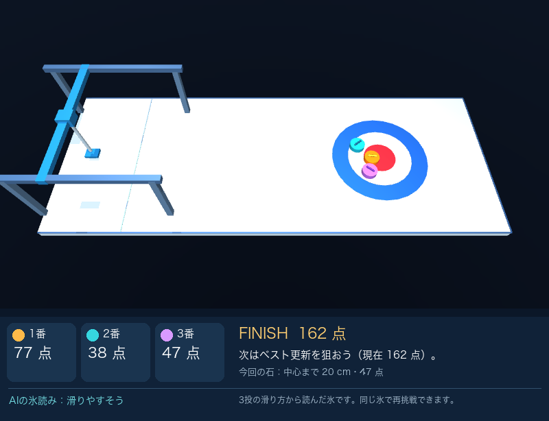
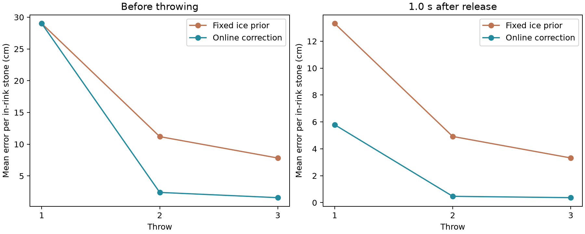
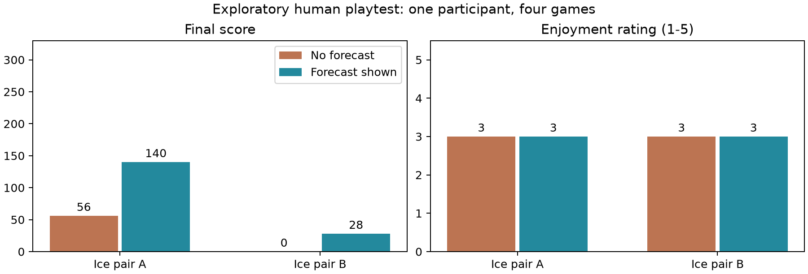
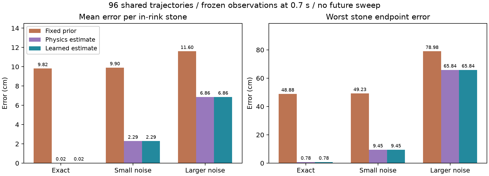

# ロボット・カーリング

更新日：2026年11月2日

## 1. 概要と目的

投球ごとに滑りやすさが変わる氷の上で、直交ロボットが3個のストーンを投げる1人用ゲーム。プレイヤーが方向・パワー・回転とスイープを操作し、AIが軌跡と衝突後の全ストーンの停止位置を予測して判断を支援する。

3投終了後の最終配置で採点する。中心は100点、距離に応じて直線的に減点し、ハウス外周にかかる石は1点、完全に外なら0点。既存の石を押し込む戦略を楽しめる独自ルールで、公式競技の採点そのものではない。

## 2. ロボットと物理の実装

Python 3.12とMuJoCo 3.17.0を使用。直交3軸と鉛直回転軸をモーターで制御し、weld拘束で保持した石を加速・回転して解放する。本番の投球結果を作るために石へ初速を直接設定していない。

石は水平2軸と回転1軸で動く平面モデル。円形同士の接触はMuJoCoで扱い、摩擦・カール・スイープは簡略化した力として計算する。氷の融解や微細な表面構造の再現は対象外。

プレイ画面はハウスの拡大、方向0.5度・パワー1ずつの微調整、1投後の予想合計点に対応する。停止後は中心までの距離・増減点・各石の点数を表示し、同じ氷で再挑戦できる。新しい表示による楽しさの向上は未評価。

## 3. 事前学習とゲーム中補正

学習189投、調整72投で、自由滑走の減速率と方向変化から摩擦・カール係数を推定する小規模な教師あり回帰を学習した。既知のスイープ作用と回転・速度の関係を利用する。モデル重みはゲーム中に変えず、0.6秒の観測窓から推定値を逐次補正する。

真の氷パラメータは推定器へ渡さない。保持中・接触を含む区間・停止直前を除外し、回転がなくカールを識別できない場合は前の推定を保持する。独立した予測世界に観測可能な状態だけを復元し、『これ以降スイープなし』で全石を先読みする。

役割の分担：人が投球を決める→ロボットが保持・加速・解放する→動きを観測する→学習モデルが氷を推定する→物理計算が停止位置を予測する→人が次の狙いを調整する。係数の推定と軌跡の計算を分けた構成である。

## 4. 3投ゲームでの比較

氷の初期値・増減・カール係数を変えた24ゲーム（72投）で、固定した氷を仮定する予測と、補正する予測を同一の入力・盤面で比較した。位置・速度はシミュレータから直接取得し、この統合評価では観測ノイズを加えていない。

投球前の平均停止位置誤差（固定→補正）：1投目 29.01→29.01 cm、2投目 11.20→2.41 cm、3投目 7.83→1.58 cm。場内で停止した各石をIDで対応付けて計測した。1投目はまだ観測がないため両者が同じになる。

## 5. 工夫した点

氷の変化とスイープの影響を分離し、次投へ推定を引き継ぐ。リトライでは同じ氷の系列と盤面に戻し、オンライン補正だけを初期化する。AIは人の投球コマンドを変更しない。描画と先読みを分け、古い入力に対する予測を画面へ反映しない。

初期の3D円柱接触では微小な摩擦変更でも連鎖衝突の停止位置が大きく変わるケースがあったため、比較実験を行い平面モデルへ変更した。見た目の3Dとロボットの保持・解放は維持し、数値的な不安定さを減らした。

## 6. 失敗例と限界

別の衝突検証96投では、小さい合成観測ノイズの平均誤差が正面2.71 cm、かすり2.58 cm、連鎖1.76 cm。大きいノイズではかすり衝突に最大65.84 cmの誤差と接触の見落としが残った。平均だけで予測の確実性を判断しない。

本番と予測は同じ物理法則を共有し、画像認識・実機・実氷での検証は行っていない。同じ入力なら得点も同じなので、この固定入力の数値評価は予測精度の比較であり、人の得点向上を示すものではない。多関節アーム・スイープ助言は追加していない。

## 7. 再現と成果物

READMEに環境構築と操作を記載。game.pyから起動・評価・動画・説明資料の再生成を実行できる。学習モデルと評価記録はreport/に保存している。コード作成・検証・資料整備に生成AIの支援を使用した。

動画：video/game_demo.mp4（148.20秒、1280×720、25 fps）。同じゲーム実装での入力記録再生で、動作部分は等速。提出先への登録や公開は行っていない。

## 8. 比較方法

本人1名が練習2ゲームの後、本番4ゲーム（各3投）を実施した。同じ氷の2組で予測表示あり・なしを比較し、A組はあり→なし、B組はなし→ありの順とした。投球操作は本人が自由に選択し、各ゲーム後に5段階の感想を回答した。練習は集計から除外した。

## 9. 結果と解釈

最終得点（なし→あり）：A組 56→140点（+84点）、B組 0→28点（+28点）。2組の平均差は+56.0点だった。今回の4ゲームでは予測あり条件の得点が高かったが、人数・試行数が少なく、慣れや氷を経験した記憶、期待の影響が残る。一般的な効果や因果関係は断定しない。

5段階の感想の平均（なし→あり）：面白さ 3.0→3.0、自分で考えた感覚 3.0→3.0、操作の分かりやすさ 3.0→3.0。本番では全項目が3／5で、楽しさや自分で考える感覚の向上は確認できなかった。得点と主観的な楽しさを分けて評価した。

## 10. 実プレイで見つかった改善点

投球中に画面全体が揺れるとの指摘があった。予測メッセージの切替で映像が上下8ピクセル動くことを再現し、配置とメッセージ領域を固定した。36通りの表示切替で移動がないことを確認した。改修後、本人から操作性が改善したように思うとの感想を得たが、5段階評価の再測定はしていない。

中断なしで全ゲームが完了し、操作記録から停止位置・得点を再現できた。本番は回転なし・スイープなし。この比較には予測ガイドの有無の効果も含まれ、学習モデルだけの寄与は分離していない。改修後の感想は別の定性的な確認であり、上記の点数・評価値を更新する根拠にはしない。

## 11. 学習を使う意味の検証

固定した氷との比較だけでは、観測に応じて補正する効果と学習する効果を分けられない。物理式から摩擦・カール係数を求める対照を追加した。摩擦はスイープの作用を除いた減速率を9.81で割り、カール係数は回転・速度で正規化した進行方向の変化から求める。

3方式には同じ観測と盤面を渡す。物理式と学習モデルで特徴量、係数の範囲、事前値、カール推定の平滑化を共通にし、学習した変換係数の有無を比較する。共通の事前値と分散は既存の学習モデル由来であり、事前情報がない推定器との比較ではない。

## 12. 条件と結果

未学習の氷8組、4配置、3回転の既存96投を使用した。解放0.7秒後までの観測を固定し、その後はスイープなし。3段階の観測ノイズで同じ96投を再利用したため、288投の独立実験ではない。既存の固定・学習方式の結果との一致も検証した。

場内で停止した石の平均誤差：正確な観測：固定 9.815 cm、物理式 0.020 cm、学習 0.020 cm。 小さい合成ノイズ：固定 9.904 cm、物理式 2.288 cm、学習 2.288 cm。 大きい合成ノイズ：固定 11.600 cm、物理式 6.865 cm、学習 6.865 cm。

既知の物理法則と共通の特徴量を使うこの条件では、物理式と学習の誤差は近かった。観測による補正の有効性は示せるが、学習が不可欠・物理式より優位とは主張しない。未知の物理、実センサーや実氷への頑健性は未検証である。

